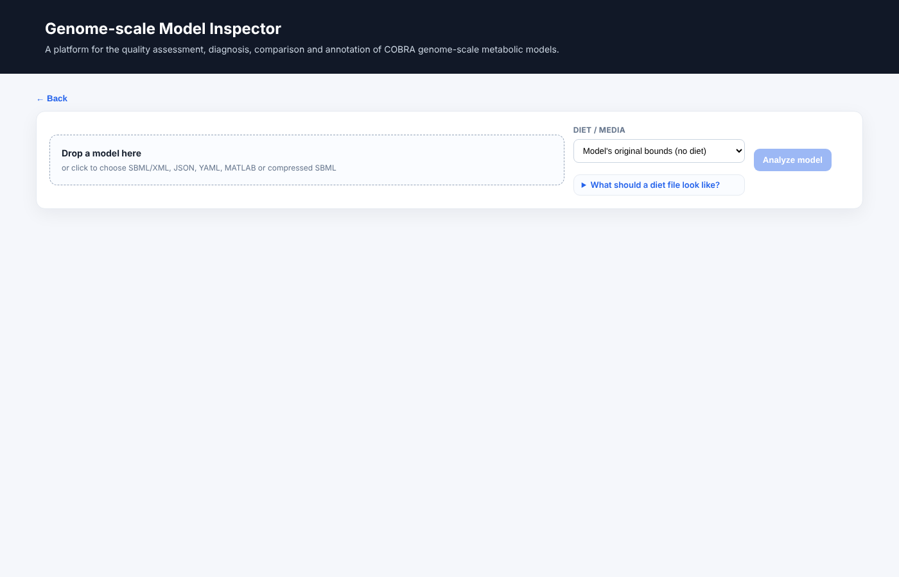
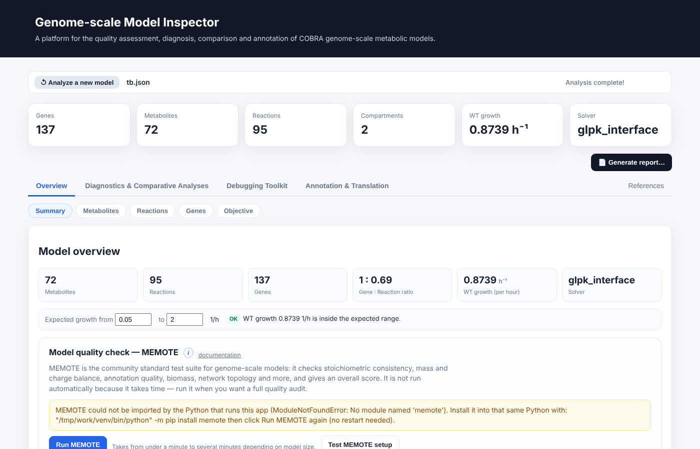

# Running and deploying

## Starting the application

```bash
python app.py [--solver {auto,gurobi,cplex,glpk,scipy}] [--threads N] [--processes N]
```

The server listens on `127.0.0.1:5000` and runs in Flask debug mode, which reloads the code when a source file changes. This mode is intended for single-user local use. For anything shared, use the deployment configuration below.

## A first analysis



1. **Choose a workflow.** *Inspect a single model* opens the four analysis modules; *Analyze multiple models* produces a side-by-side comparison with quality findings (see [Reports and exports](../guide/reports.md)).
2. **Upload a model** in SBML (`.xml`, `.sbml`), JSON, YAML or MATLAB (`.mat`) format, optionally compressed (`.gz`, `.zip`, `.bz2`). Files up to 500 MB are accepted.
3. **Select a medium.** The model's own bounds are used by default. The alternatives are a complete medium (all exchanges open), a computed minimal medium, or a custom medium supplied as a two-column table of exchange identifier and uptake bound. An example file can be downloaded from the upload page.
4. **Press Analyze.** The summary cards appear, and the four modules become available. Heavy analyses (MEMOTE, network gaps, FROG, balance audit) run only when requested; none runs automatically.



Every analysis can be started in any order and is independent of the others. Where two analyses need the same intermediate result, for example the flux variability analysis used by both the blocked-reaction step and the FROG report, the result is computed once for the loaded model and reused.

!!! info "The model is never modified"
    Hypothetical changes, such as a knockout or a different medium for a single test, are applied in a temporary context and reverted. The loaded model remains as uploaded (plus the medium chosen at upload).

## Sessions

A loaded model is held in memory and expires after ten minutes without activity. If a request reports that the model has expired, re-run the initial analysis. Cached results are discarded together with the model.

## Deployment

The application keeps loaded models and computed results in the memory of the server process. A deployment must therefore use **a single worker process**, with multiple threads for concurrency. With several worker processes a request may reach a process that does not hold the user's model.

The supplied `Dockerfile` does this:

```dockerfile
CMD exec gunicorn --bind :$PORT --workers 1 --threads 8 --timeout 0 app:app
```

Without Docker:

```bash
python -m pip install gunicorn
export GEM_SOLVER=auto GEM_THREADS=4 GEM_PROCESSES=2
gunicorn --bind 0.0.0.0:8000 --workers 1 --threads 8 --timeout 0 app:app
```

`--timeout 0` disables the worker time-out, which is needed because analyses such as GapFind on a large model can run for minutes.

### Behind a reverse proxy

If the service is placed behind nginx, raise the request-size and time-out limits to match the application:

```nginx
client_max_body_size 500m;
proxy_read_timeout 3600s;
proxy_send_timeout 3600s;
```

### Operational considerations

* **Authentication.** The application has none. When exposing it beyond a trusted network, place it behind an authenticating proxy.
* **Capacity.** Each loaded model occupies memory until it expires, and heavy analyses occupy cores. Size the host for the expected number of simultaneous users (see [Solvers and computing resources](solvers.md#cpu-memory-and-gpu)).
* **Hosted mode.** Set `GEM_HOSTED=1` (the supplied `Dockerfile` does) so that the report-saving routes, which write to a path on the server, are disabled; reports are then downloaded through the browser.
* **Licences.** A commercial solver on a shared server must be covered by a licence that permits it. If it is not, run with `--solver glpk` or `--solver scipy`.
* **Privacy.** Models are processed on the host and are not forwarded to external services. A hosted instance, however, places the models on the host's disk and memory, and the host operator can see them.
