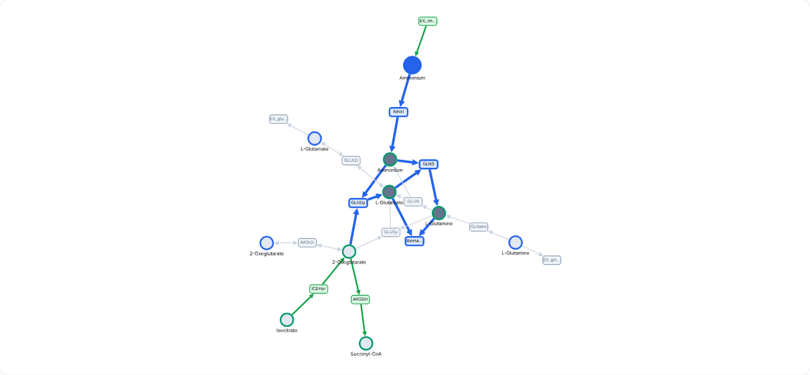
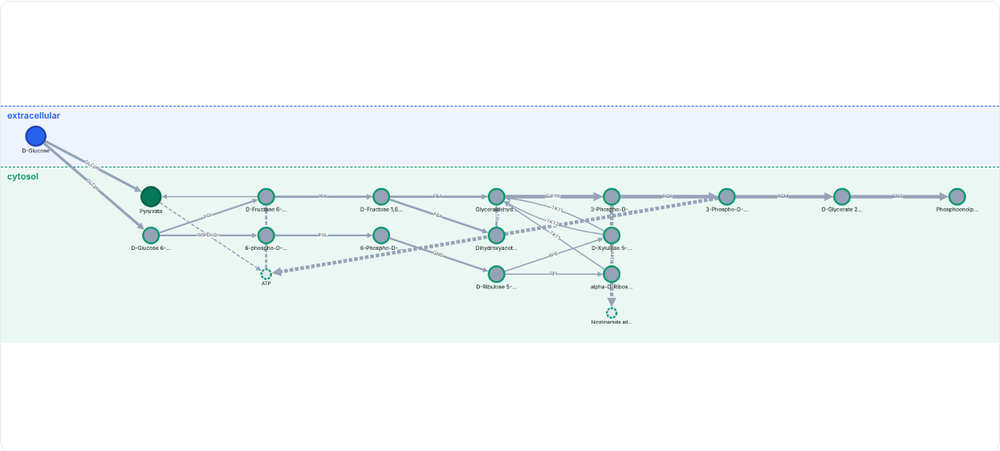

# Debugging toolkit

The debugging module supports the step after detection: understanding why the model behaves as it does. It traces the actual flux-carrying routes of the current solution.

## Exchange debugging {#exchange-debugging}

The tab maps how the metabolite of one exchange reaches biomass. Essential exchanges are listed first; the remaining exchanges are available under *Show non-essential exchanges*, with a search box. The map has two parts.

* **Primary route.** The active-flux route from the exchanged metabolite to the biomass reaction in the current FBA solution (blue). The same route is also listed as text.
* **Neighbourhood.** With *Hops* set to 1, 2 or 3, every reaction that touches a metabolite on the route is added, then every reaction that touches the new metabolites, and so on. Reactions are drawn as boxes between the metabolites they consume and produce, with arrows in the direction of flux. Reactions that carry flux are green, those that carry none are grey, and reactions whose bounds are both zero are dashed red. A two-headed arrow marks a reversible reaction with no flux. Currency metabolites (the editable list) are left out and listed in the hover card of each reaction. Hover a node for its equation, bounds, subsystem and gene rule.

*Before knockout* and *After knockout* switch the flux shown. For an essential exchange growth is lost after the knockout, so no flux distribution is defined and every reaction is shown as inactive; for a non-essential exchange the flux of the re-optimised solution is shown. *Show inactive reactions* can be cleared to display only the routes in use, and the reactions in the map are listed in a table that can be downloaded as CSV.

For an essential exchange that should not be essential, the neighbourhood is the place to look for a missing or blocked step: reactions around the route that have no flux, are blocked by their bounds, or have no counterpart in the direction needed. The map is limited to 300 reactions (active reactions are kept first); lower the number of hops or hide more cofactors to see everything.

## Pathway tracer

The tracer finds routes between a start and a target, each of which can be a **metabolite or a reaction** (pick from the list or type to search). A reaction start is resolved to the metabolites it produces, a reaction target to the metabolites it consumes. The result is drawn like the exchange map: route reactions in blue, the neighbourhood around them, and a table of every reaction shown.

| Option | Effect |
|---|---|
| Routes | *Active flux only* follows reactions carrying flux in the current solution. *All possible routes* follows every reaction whose bounds allow the direction, whether or not it carries flux, so alternatives and blocked links become visible. Shortest routes are listed first. |
| Hops | Adds every reaction within this many steps of the routes, active or not. |
| Max levels, max paths | Bound the route length and the number of distinct routes. |
| Hide cofactors | Excludes currency metabolites such as H⁺, water and ATP/ADP as route steps. The list is editable via *Currency list*. |
| Also show | Pick metabolites or reactions to always include in the map (reactions are outlined in purple). A cofactor added here is shown without being used as a route step. |
| Knock out | Pick reactions (or metabolites, which block every reaction they take part in). The map gains a before/after toggle; reactions that lose or gain flux are highlighted, and the growth impact is shown. If growth is lost, no flux is shown after the knockout. |

The map offers clustered, tree and **compartment lanes** layouts, a *Find a node* box, hover cards, and a reactions table with CSV download. The table leaves out the biomass reaction unless *Include biomass reaction* is ticked. The method is described in [Pathway tracing](../methods/tracing.md).

### Explore: draw your own graph

The *Explore* sub-tab of the tracer is for the case where you do not yet know the route. Start from any metabolite or reaction and grow the graph one step at a time: click a node and choose **Upstream** (reactions that can make a metabolite, or what makes a reaction's substrates), **Downstream** (reactions that can use it) or **Both**; a double-click expands both ways. Direction is judged from the reaction bounds, so a reversible reaction counts both ways. Cofactors stay hidden unless you add them yourself.

| Feature | What it shows |
|---|---|
| Node colours and shapes | Reactions are active, inactive or blocked (bounds, or FVA when it has been run); a lock marks an essential reaction; dead-end metabolites (when that analysis has run) get a dashed red outline. Arrows follow the flux, or the direction the bounds allow. |
| Test metabolites | For every metabolite drawn, a temporary demand reaction (can the network make it?) and a temporary supply (can it use it?) are tested under the current bounds, without changing the model. Green means yes, red means no. |
| Trace the break | Expands every unmakeable metabolite upstream (or every unusable one downstream), retests the new metabolites and repeats for the chosen number of rounds. It stops where metabolites can be made again, so the red metabolites left are the first ones on each branch that cannot be made. *Show only the problem area* hides everything else. |
| Details panel | Click a node for its equation, bounds, flux, FVA range and a one-line diagnosis, for example that nothing in the model produces a metabolite. |
| Output | Find a node, zoom, PNG, and a CSV of every node drawn with its diagnostics. |

The test asks whether the network *can* make or use a metabolite at all; it does not say which reactions to add. Each expansion adds at most 40 reactions (active ones first).

## Compare models

Two models are compared by naming convention first (metabolite and reaction namespaces, compartment tags), then by genes, metabolites, reactions and biomass components, listed as shared, only in the first or only in the second. Reactions are also paired by equation, and differences in bounds and coefficients are reported. Each list can be copied or exported as CSV with MetaNetX identifiers alongside the model identifiers.
