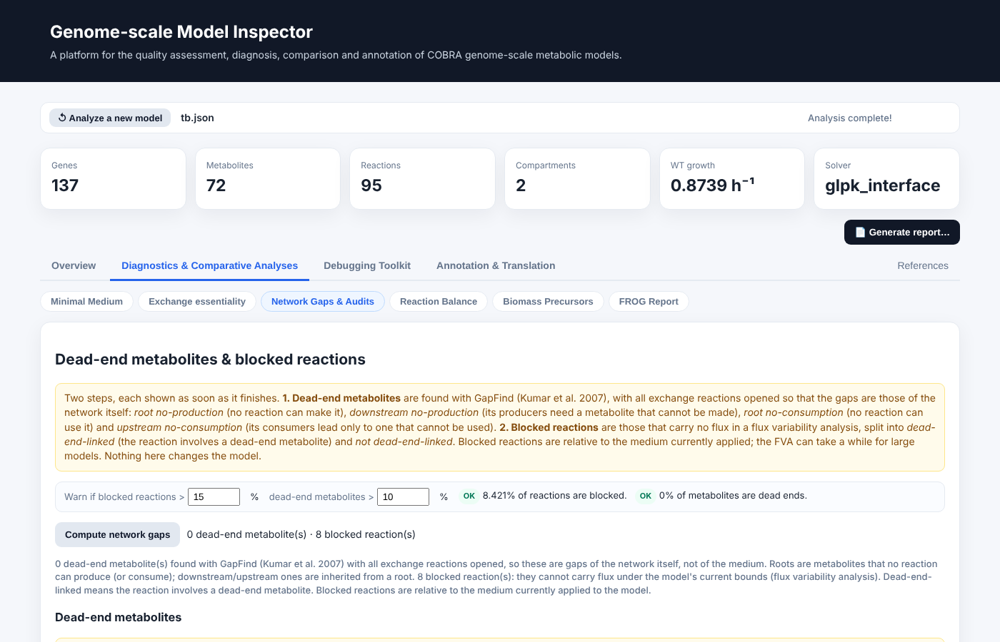
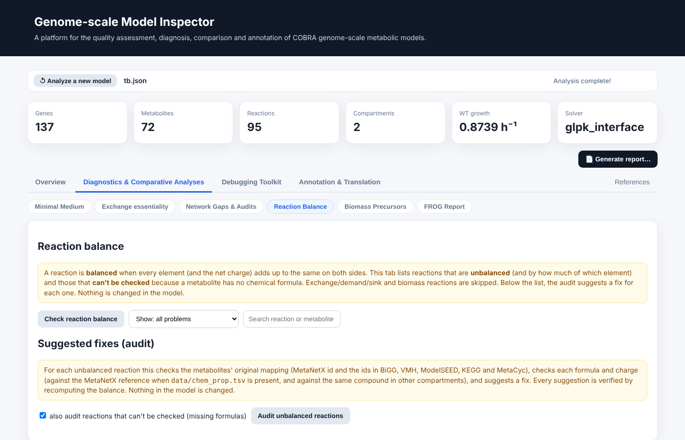

# Diagnostics and comparative analyses

This module contains the analyses that locate structural and environmental causes of model behaviour. All are computed on request, and none alters the loaded model.

## Minimal medium

Finds the smallest set of nutrients that allows a chosen fraction of the maximal growth rate, between a sliver of the optimum and 100 %. The default objective minimises the total uptake flux; an alternative minimises the *number* of components, which is a MILP. Each nutrient is listed with its required uptake, and the table can be exported as CSV. This analysis is independent of the medium selected at upload, which it never changes.

## Exchange essentiality

For every exchange reaction, the tool blocks the exchange and records the resulting growth. An exchange is flagged as essential when growth falls below 5 % of the wild-type value. This is the fastest way to see which nutrients a model cannot do without, and its output is the entry point for [exchange debugging](debugging.md#exchange-debugging).

## Network gaps and audits

The tab runs in two steps, each displayed as soon as it finishes.

1. **Dead-end metabolites** are identified with the GapFind formulation and classified as *root no-production*, *downstream no-production*, *root no-consumption* or *upstream no-consumption*.
2. **Blocked reactions** are identified by flux variability analysis and grouped as *dead-end-linked* (the reaction involves a dead-end metabolite) or *not dead-end-linked*.

Class chips above each table filter the rows; each table can be exported as CSV, and each blocked reaction lists the dead-end metabolites it is linked to as clickable identifiers. Warning thresholds for the fraction of blocked reactions and dead-end metabolites can be set and are reused in the model report. The algorithms are described in [Network gaps](../methods/network-gaps.md).

The tab also contains the **demand and sink audit**. Demand and sink reactions are single-metabolite boundary reactions that curators add by hand and that, unlike exchanges, do not appear in the exchange essentiality scan. The audit knocks out each in turn and records whether it carries flux and whether its removal reduces growth below 5 % of wild type. A demand or sink that is inactive and not essential is a candidate for removal; one that supports growth deserves a second look because it may be compensating for an upstream gap.

## Reaction balance and audit

Every reaction is classified as *balanced*, *unbalanced* or *unknown* (a metabolite lacks a usable formula), or *not applicable* for boundary and biomass reactions. For unbalanced reactions the audit explains the cause: it maps each metabolite to MetaNetX and to BiGG, VMH, ModelSEED, KEGG and MetaCyc identifiers, flags identifiers that do not map or that belong to another namespace, and compares each formula and charge with the reference and with the same compound in other compartments. Suggested corrections, such as adopting the consistent formula or adding a common species, are verified by recomputing the balance before they are shown. Results can be copied or exported as CSV or Excel. The suggestions are offered for review; nothing is applied to the model.

## Biomass precursors

Each biomass precursor is tested in isolation: a temporary demand drains the metabolite while the biomass reaction is switched off, and the maximal demand flux is found. Each precursor is tested twice, under the applied medium and with all exchanges open. A precursor that is producible only when exchanges are open indicates a missing nutrient; one that is not producible even then indicates a gap inside the network.

## FROG report

The FROG report (Raman et al., 2024) records the four quantities of the community standard for reproducibility of constraint-based models: **F**lux variability, single **R**eaction deletions, the **O**bjective value, and single **G**ene deletions. The flux variability cut-off is configurable. Results can be inspected in the interface and exported as CSV or as a standalone HTML report. The reaction-deletion and flux-variability computations are shared with the other analyses (see [Architecture](../implementation/architecture.md#shared-computations)).
