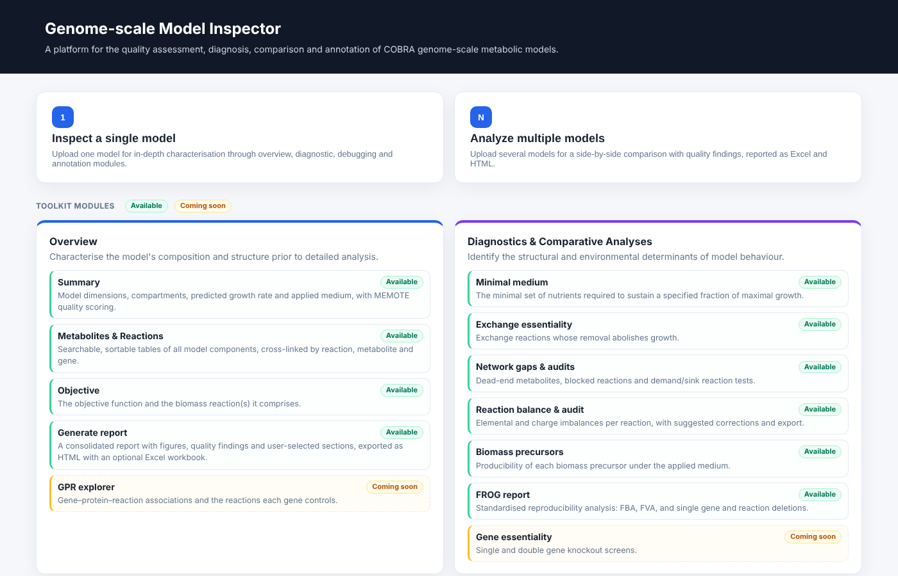

# GEM Inspector

GEM Inspector is a browser-based toolkit for the quality assessment, diagnosis, debugging and annotation of genome-scale metabolic models (GEMs). It is built on COBRApy and runs locally: a model is loaded into the memory of the machine running the application and is not sent to any external service.

Curating a GEM rarely fails at a single point. Dead-end metabolites, blocked reactions, unbalanced stoichiometry, inconsistent identifiers and unexpected nutrient requirements interact, and a flagged reaction is usually a symptom rather than a cause. The tool is therefore designed around *inspection*: it locates and classifies problems, shows the evidence, and leaves the decision on correction to the curator.

## At a glance

Every entry below links to the section that describes it in detail.

### Get started

| | |
|---|---|
| [Installation](getting-started/installation.md) | Python environment, dependencies and a first launch on Windows, macOS and Linux. |
| [Solvers and computing resources](getting-started/solvers.md) | Choosing GLPK, Gurobi, CPLEX or HiGHS; setting threads and worker processes; what to expect from CPU and memory. |
| [Running and deploying](getting-started/running.md) | Command-line options, a first analysis, Docker and gunicorn deployment. |

### What the tool does

| Module | Capabilities |
|---|---|
| [Overview](guide/overview.md) | Model statistics, metabolite, reaction and gene tables, objective, optional MEMOTE quality score, applied medium. |
| [Diagnostics and comparative analyses](guide/diagnostics.md) | Minimal medium, exchange essentiality, [network gaps](methods/network-gaps.md) (GapFind dead ends and FVA blocked reactions), reaction balance and audit, biomass precursors, FROG report. |
| [Debugging toolkit](guide/debugging.md) | Exchange debugging, [pathway tracer](methods/tracing.md) with knockouts and compartment view, two-model comparison. |
| [Annotation and translation](guide/annotation.md) | Namespace detection, MetaNetX-based translation, SEED to VMH conversion. |
| [Reports and exports](guide/reports.md) | Self-contained HTML reports, Excel workbooks, CSV exports, multi-model comparison. |

### How it works and where it stands

| | |
|---|---|
| [Methods](methods/network-gaps.md) | The algorithms behind the dead-end classification, blocked-reaction grouping, pathway tracing and the remaining analyses. |
| [Architecture](implementation/architecture.md) | Application structure, caching, process isolation and the front end. |
| [Comparison with existing tools](positioning.md) | Relation to MEMOTE, MACAW, FROG, COBRA Toolbox, RAVEN and ModelExplorer, and the scope of the tool. |
| [Benchmarks](benchmarks.md) | Agreement with COBRApy and runtime on genome-scale models. |
| [FAQ and troubleshooting](faq.md) | Common installation and runtime problems. |

## Scope

GEM Inspector identifies and classifies problems; it does not repair them. Where a correction can be proposed and verified, as for formula and charge imbalance, it is offered as a suggestion. It supports SBML, JSON, YAML and MATLAB models and uses the standard COBRApy data model, so any model that loads in COBRApy can be inspected.

## Status and licence

The software is under active development and is released under the MIT licence. Feedback is welcome; see the [FAQ](faq.md) for how to report an issue.
